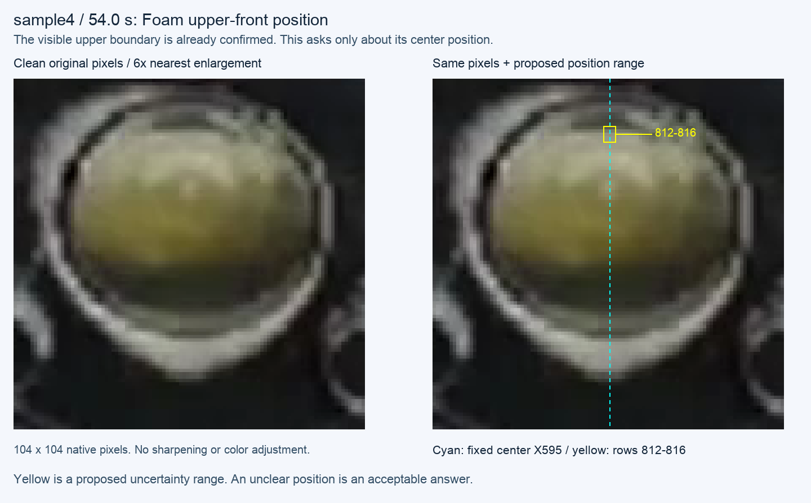

# P5 raw-front prerequisite — sample4 upper Foam source position

**Position checkpoint CLOSED:** the user replied **“범위 맞음”**. The
[bound reply](2026-10-11-foam-upper-position-reply.json) qualifies source rows
812–816 (pixel-cell bounds 811.5–816.5) at X595 in this frame only. The
preparation record remains byte-for-byte unchanged with its original pending status.

**At preparation:** the
[question and pixel-verification record](2026-10-11-foam-upper-position-review.json)
binds the original sample4 f1620/54 s ROI, Recipe center X595, and an agent-proposed
source-row interval 812–816 (pixel-cell bounds 811.5–816.5).
[Work Plan](../../00-project/work-plan.md) owns the live checkpoint.

The earlier replies already establish visible upper Foam, internal texture at
the old Y833 guide, and the upper neighboring glass feature. None certifies the
true Foam upper position at this fixed column. This question concerns this
position interval only; it does not reopen presence, visibility or regional role.
The agent sees the upper Foam transition within the proposed band but cannot
turn that interpretation into human-qualified position truth.

The source renderer reuses the existing October 10 source-position review layout:
clean native pixels on the left, the same nearest-enlarged pixels and a proposed
interval on the right. The clean panel is checked byte-for-byte against a 6×
nearest expansion. Original image/Recipe/reply hashes remain unchanged; no image
enhancement, source-video decode or detector execution occurred. The JSON keeps
the full renderer source and the six input hashes.

The [P2-S1 pilot](2026-10-11-p2-shared-support.md) has closed without promotion.
The program explicitly allows this P5 prerequisite independently of Oil
association. Before a bounded raw-front comparison, qualify whether this late
target-domain positive can support fixed-column interval compatibility. Water
A's separately qualified Foam upper interval, earlier real fronts, all three
internal-texture negatives, rim and beer/milk visibility controls stay in scope.

A positive reply qualifies only this frame/column interval; box width is display
decoration, not reviewed X support. An unclear reply keeps this source
qualitative-only. Neither answer supplies exact Y, a contour, layer thickness,
neighboring-frame labels or a production front selector. Do not use the proposed
band numerically until the reply is bound; that condition is now satisfied only
at the scope above. Keep raw-front representation separate
from physical identity and keep the episode resolver unchanged.

## Qualified interval joined to saved observations

The [complete comparison](2026-10-11-foam-upper-position-comparison.json) and
[reproducer](2026-10-11-foam-upper-position-comparison.py) join this newly qualified
interval to previously exposed, unchanged arrays. The interval is an evaluation
input only; no candidate or alternative is generated from it. This is a causal
audit, not a prospective efficacy trial or a physical selector.

`current` and `sequence` below name layers of the preserved v2 scoped sample4
replay, not a new application run. The earlier causal audit established raw Foam
equality between OFF and scoped captures; the scoped final sequence does not
establish adoption or acceptance of that experimental configuration.

At f1620, source origin is (543,798), so X595 is local column 52:

| Saved stage | Observation at the qualified column | Meaning |
|---|---|---|
| Native Canny and lossless edge graph | Y813 | An interval-compatible observed edge exists before material support or candidate selection. |
| Raw/clean white support and retained C1 | First occupied center row Y813; rows813–816 retained | This column's upper support is not erased by the white predicate or cleanup. |
| Existing unsigned gradient alternatives | Plateau [813,814) at both fixed radii 4 and 8 | The physical interval is represented without the later signed-gap extension. |
| Existing signed bracket, radius 8 | Upper [808,809), lower [813,814), trough minimum Y810 | Both alternatives remain; the reply does not make every lower gap member a Foam front. Radius 4 has the Y813 peak but no fully bracketed pair. |
| Whole C1 extent | Global top Y808; global bottom Y833 | Neither extreme is compatible with [811.5,816.5]. Replacing the lower extreme with the global upper extreme would still fail this comparison. |
| Current raw Foam candidate, input index22 | Y833, lower-edge rule true | This is the already reviewed internal texture, at least 16.5 px outside the qualified interval. This is distance to an uncertainty interval, not exact-Y error. |
| Current smoothed / completed sequence | Current smoothed Y813; final raw/smoothed Foam null | The smoothed coincidence is not same-frame candidate provenance. The episode rejects the Y833 trajectory; it did not discard a correct Y813 candidate. |

The first supported harmful stage here is raw component-to-front reduction in
`_detached_material_phenotype` / `_component_evidence`: a structural-substrate
bounding-box relation requests the lower extreme before candidate assembly and
episode processing. The saved candidate has `sequence_foam_eligible=true`, but
the later formation witness fails. No raw Y813 Foam candidate reaches that gate.
This strengthens the earlier [texture causal finding](2026-10-09-local-xy-sequence-causality.md)
with a qualified positive location; it does not authorize a top/center/nearest
edge substitution or relaxation of the formation witness.

The already qualified [water A/B/C join](2026-10-10-abc-source-interval-comparison.md)
is rechecked directly from its saved arrays. A has an interval-compatible Canny
edge at Y477, but no compatible retained appearance face. Its lightness/whiteness
predicate loses support before cleanup, unlike sample4. B/C remain water-upper
positives with no Foam layer; their raw edges do not turn them into Foam. Thus a
support-perimeter-only repair would retain sample4's center evidence while still
missing A. Neither lowering the white threshold nor blanket union is adopted.

All seven sample4 frames remain in the record, including the three internal-
texture negatives, earlier real-front/mixed/rim controls and unreviewed f1635.
Only f1620 gains a numeric Foam-upper interval. All 25 previous edge graphs,
including water inclined/empty, beer rear/front and cropped-upper, and milk
unclear-lower controls, remain pinned. Their regional roles are not converted to
dense labels or successful rejections. Beer cropped upper remains unmeasured;
milk's unclear lower is not filled with an Oil value.

Verification passed from `/tmp` with an explicit repository root: direct byte
arithmetic reproduced **66 existing peaks and 19 gap pairs** at the fixed center
across seven frames; all center graph vertices equal visible Canny pixels. The
three native A/B/C joins reproduce all saved center edges, support-stage samples
and appearance-face crossings. All 25 graph array hashes and **221 production
Python hashes** remain unchanged. No video decoding, preprocessing, detector,
episode or new selector ran. This checks the saved-data join, not field efficacy.
The reproducer requires the preserved local `sample/output` captures named and
hashed in the record; it writes a new JSON path and refuses an existing output.

The raw-representation prerequisite is closed at this scope. Reuse the existing
edge graph, signed alternatives and side-support observations; a duplicate edge
generator would not address the established failure. The next mechanism needs
independent material/structural role evidence at an observed boundary, including
Foam support that is dark in A, before any front is selected. It must oppose
the rim and internal texture on the same current support and retain unavailable
and visibility cases. P2-S1's failed appearance-reference comparison is not
rescued by replacing its reference with the newly qualified Y813. No episode
change is justified until correct raw fronts are independently selected and a
separate loss is demonstrated downstream. Work Plan owns that next design entry.

## Detector Governance

- Logic-map nodes: `FRAME-EVIDENCE`, `FOAM-CANDIDATE`, `FOAM-IDENTITY`
- Failure-registry entries: `S11-F07`, `S11-F09`, `S11-F10`
- First harmful stage: sample4 retains interval-compatible Y813 in raw edges, local white support and existing alternatives, then reduces C1 to internal-texture Y833 before episode processing. A's separate support loss remains at the lightness/whiteness predicate. No candidate approval or exact Y follows from either interval join.
- Logic-map impact: NONE — this is a source-position review artifact with no runtime or diagnostic inference consumer.
- Failure-registry impact: NONE — F07 already owns component-extreme/internal-texture failure and the no-upper-substitution rule; this source-bound comparison adds a qualified location and preserves F09 provenance and F10 controls without a new mechanism or field claim.
