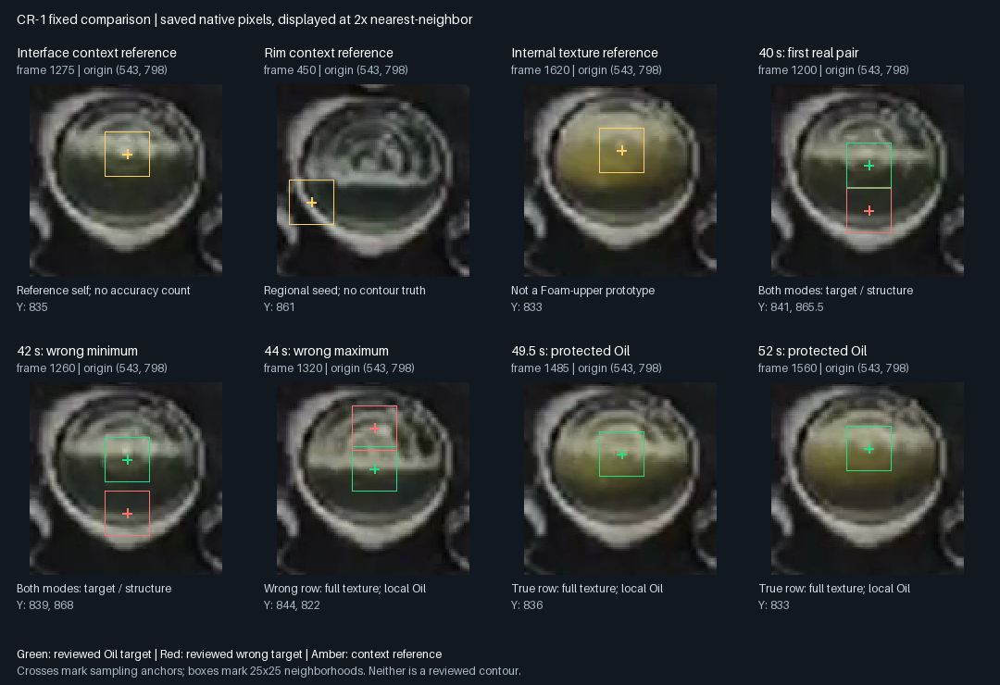

# CR-1 후보 문맥 비교와 유용성 검토 — 2026-10-12

**결과: 검토 완료 / SCOPE_LIMITED_USEFULNESS / 제품 승격 없음.**
고정된 DINOv2 표현에서 기존 평균 진단과 다른 정보는 확인했다. 국소 문맥은
참조 자신을 제외한 검토 Oil 후보 6개를 모두 유지하지만 44초의 잘못된 대상도
유면으로 선호한다. 전체 문맥은 알려진 잘못된 대상 3개를 모두 대립 문맥으로
선호하지만, 49.5초·52초의 실제 Oil 후보를 놓친다. 두 방식 모두 미검토 대안을
여러 개 남기므로 물리적 후보 선택이나 추적 개선을 입증하지 못했다.

현재 단계와 후속 권한은 [Work Plan](../../00-project/work-plan.md)이 소유한다.
환경·모델·cache는 **결과와 관계없이 사용자가 정리를 요청할 때까지 보존**한다.
O2 OPEN / FIELD FAIL / Local XY OFF와 생산 의존성·동작은 그대로다.

## 1차 결과와 후속 기준의 구분

[1차 preflight](2026-10-12-cr1-context-comparison/preflight.json),
[실행 결과](2026-10-12-cr1-context-comparison/readout.json),
[검증](2026-10-12-cr1-context-comparison/verification.json)은 변경하지 않았다.
실제 encoder를 거친 합성 문맥·동점·결측 대조는 PASS였다. f1200의 두 실제 후보도
전체·국소 문맥 모두 기대 선호를 냈다. 그러나 1차 조건은 국소 방식이 하나 이상
틀려야 했으므로 stage2 FAIL, stage3 NOT_RUN, CLOSED_WITHOUT_PROMOTION이다.
이는 이 조건에서 넓은 문맥의 추가 이득을 보이지 못했다는 결과다.

사용자는 프로젝트의 판독 보조 목적에 맞춰 전체 후보의 유용성을 검토하도록
기준 보완을 채택했다. [채택된 계약](../../20-architecture/s11-contextual-role-observation-design.md#adopted-usefulness-follow-up-and-review-completion)에
따라 [별도 후속 preflight](2026-10-12-cr1-context-comparison/followup-preflight.json)를
추가 추론 전에 동결했다. 모델·가중치·참조·support·정규화·선호 연산은 그대로다.
1차의 두 측정과 합성 검증을 재사용했고 나머지 162개 기록을 한 번 비교했다.
국소 방식의 성공은 후속 중단 조건이 아니다. 기존 실패의 소급 PASS, threshold
탐색, 두 표현의 OR/AND 결합 또는 후보 선택 규칙 추가는 하지 않았다.

## 입력·연산·노출

- [Readiness](2026-10-12-cr1-context-comparison/readiness.json)에 공식 DINOv2
  ViT-S/14 revision, 가중치 SHA-256, 12개 의존성 버전/라이선스와 source hash를
  고정했다. [Lock](2026-10-12-cr1-context-comparison/requirements.lock)을 보존한다.
- 기존 S1 `load_images`와 후보 inventory를 재사용했다. 저장한 Canny/glare와
  현재 전처리가 일치하며, 221개 생산 Python source를 포함한 273개 입력/source
  pin이 유지된다. 영상 재decode나 detector/sequence replay는 하지 않았다.
- 참조는 f1275 Oil 주변, f450 rim seed, f1620 내부 texture다. 후보 scalar와
  기존 문맥 marker는 sampling anchor이며, contour나 순수 물질 mask가 아니다.
  Foam upper prototype은 없다.
- 104×104 ROI를 동일한 224×224 canvas로 변환한다. 국소 방식은 25×25 밖을
  평균 RGB로 바꾼다. 같은 native 배율·token lattice·상하측 strip과 공통 유효
  column을 쓴다. 분수 Y는 floor/ceil을 모두 보존한다. 14-pixel token은 원본
  6.5 pixels에 해당하며 보간으로 native 위치 정밀도가 생기지 않는다.
- 전체 164개는 원래 episode 제외 규칙상 평가 가능한 개발 기록 91개,
  참조 인접 episode 진단 71개, 참조 자체 support 2개다. **모두 노출된 sample4
  한 recording**이며 독립 source/holdout은 없다. 42·44초는 인접 episode
  진단으로만 계산했고 기존 제외 분모에 소급 편입하지 않았다.

132개 기록을 측정했고 32개는 미측정으로 보존했다. 그중 14개는 완전한 crop이
없고 18개는 공통 mask support가 부족하다. 총 167개 정수 anchor 대안 중
135개를 측정했다. 동일 좌표의 24개 중복 group도 원래 index대로 남기지만
독립 성공으로 세지 않는다. 150개 미검토 후보의 물리적 라벨은 추가하지 않았다.

## 전체 후보 결과

[전체 readout](2026-10-12-cr1-context-comparison/followup-readout.json.gz)은 모든
후보의 점수·margin·결측·token 가중치·노출·기존 평균 결과를 포함한다.
[판정 기록](2026-10-12-cr1-context-comparison/interpretation.json)은 한계와 후속 경계를
연결한다. 아래 숫자는 검토된 후보 문맥의 선호이며 영상 검출 정확도가 아니다.

| 방식 | 비자기참조 실제 Oil의 유면 선호 | 잘못된 대상의 구조/texture 선호 | 잘못된 대상의 유면 선호 | 잘못된 대상의 미확정 |
|---|---:|---:|---:|---:|
| 기존 평균 진단 | 4/6 | 2/3 | 0/3 | 1/3 |
| DINOv2 전체 문맥 | 4/6 | 3/3 | 0/3 | 0/3 |
| DINOv2 국소 문맥 | 6/6 | 2/3 | 1/3 | 0/3 |

위 표의 양성 6개 중 2개와 거절 대상 3개 중 2개는 참조 인접 진단이다.
인접 episode 밖의 검토 대상은 양성 4개/거절 1개뿐이다. 이 그룹에서는 전체
문맥이 양성 2/4, 국소 문맥이 4/4를 유지하며 두 방식 모두 거절 대상 1개를
구조 문맥으로 선호한다. 초기 Oil 참조 1개는 양성 6개에서 제외했다.

| 시점 | 저장된 application 최종 Oil Y | 실제 Oil 후보: 전체 / 국소 | 검토된 잘못된 후보: 전체 / 국소 |
|---|---:|---|---|
| 38 s | 844 | 유면 / 유면 | 해당 검토 없음 |
| 40 s | 865.5 | Y841: 유면 / 유면 | Y865.5: 구조 / 구조 |
| 42 s | 868 | Y839: 유면 / 유면 | Y868: 구조 / 구조 |
| 42.5 s | 835 | Y835: 유면 / 유면 — 참조 자체 | 해당 검토 없음 |
| 44 s | 822 | Y844: 유면 / 유면 | Y822: texture / 유면 |
| 49.5 s | 836 | Y836: texture / 유면 | 해당 검토 없음 |
| 52 s | 833 | Y833: texture / 유면 | 해당 검토 없음 |

Application 값은 [기존 기본 실행](2026-10-11-p5-default-linkage/readout.json)의
최종 tracking 값이다. 원시 검출값과 혼동하지 않는다. 예를 들어 40초 raw Y841은
실제 후보지만 최종값은 Y865.5다. 같은 프레임/Y의 후보를 모두 연결했으며
좌표가 같은 다른 index에 사람의 라벨을 전파하지 않았다.

전체 문맥의 44초 texture 우세는 **0.002718**의 작은 cosine 차이다. 국소 문맥의
52초 유면 우세도 **0.001624**다. 고정 tie 기준에서는 유일 최댓값이지만 물리적
판정의 신뢰도나 배포용 margin을 뜻하지 않는다. 평균 진단과 CR-1은 support와
운영 규칙이 달라 결과를 대조할 수 있어도 raw score 크기를 직접 비교할 수 없다.

대안 경쟁도 남는다. 프레임별 유면 선호의 서로 다른 Y 수는 다음과 같다.

| 시점 | 전체 문맥 | 국소 문맥 | 기존 평균 |
|---|---:|---:|---:|
| 38 s | 5 | 11 | 4 |
| 40 s | 3 | 10 | 3 |
| 42 s | 11 | 13 | 5 |
| 42.5 s | 8 | 11 | 5 |
| 44 s | 5 | 11 | 5 |
| 49.5 s | 1 | 10 | 2 |
| 52 s | 1 | 8 | 3 |

전체 문맥의 49.5초 유일 Y814와 52초 유일 Y846은 미검토다. 알려진 실제 후보를
놓친 대신 이 대안을 성공으로 세지 않는다. 서로 다른 Y가 여러 개 남는 현상도
모두 오검출로 단정할 수는 없지만, 하나의 물리적 대상을 선택했다는 근거는 아니다.

그림은 저장 원본을 2배 nearest-neighbor 표시한 것이다. 십자는 기존 anchor,
사각형은 sampling 이웃이다. 초록은 기존 검토 Oil 대상, 빨강은 기존 거절 대상,
노랑은 참조 문맥이며 새 contour/물리 라벨을 만들지 않았다. 8개 panel의 표시를
직접 확인했다.

## 검증·자원·보존

[독립 저장결과 검증](2026-10-12-cr1-context-comparison/followup-verification.json)은
164개 원본 연결, 167개 공통 support, 270개 score 순위, floor/ceil 합의,
24개 중복 group, 노출 분리, baseline 연결과 221개 생산 source 불변을 확인했다.
실제 token에 대한 별도 `grid_sample` 보간 대조의 최대 차이는 3.56e-15 미만이다.
좌표 원점 이동, 복제 참조 동점, 누락 class 결측도 통과했다. 이것은 저장결과와
계산 경로 검증이며 독립 모델 재현이나 새 물리 정답 시험은 아니다.

문서·증거 연결 362개, S11 governance, 관리 실행 4개의 closeout, Python/JSON
구문과 diff 공백 검사도 통과했다. 생산 코드 변경이나 전체 detector 시험 결과를
대신하는 검증은 아니다.

- 1차: 19 forwards, 총 11.51초, model load 10.18초, peak RSS 597 MB.
- 후속: 새 146 forwards, 총 9.91초, model load 4.67초, peak RSS 602 MB.
  두 실행 누적 165 forwards로 상한 420 이내다. CPU 2 threads/float32 encoder다.
- 후속 저장 PNG/mask decode는 0.025초다. 원본 video decoder, 전체 detector,
  Windows 처리량·패키지 비용은 측정하지 않았다.
- 런타임 network/외부 쓰기 guard는 의도한 smoke 거절 두 건만 기록했다.
  Python audit 검증이며 native code에 대한 OS 격리 증명은 아니다.
- 모델·환경은 한 벌, token map 보존은 0개다. 전체 작업공간과 외부 증거 합산은
  [보존 receipt](2026-10-12-cr1-context-comparison/retention.json)에 있으며 3 GB 이내다.
  완료 관리 실행은 동결했고 환경·가중치·cache와 준비 입력은 유지했다.

재현 경로는 [준비기](2026-10-12-cr1-context-comparison/prepare.py),
[1차 측정 owner](2026-10-12-cr1-context-comparison/probe.py),
[후속 adapter](2026-10-12-cr1-context-comparison/followup.py),
[독립 검증기](2026-10-12-cr1-context-comparison/verify_followup.py)다. 준비 실행의
`work/`는 closeout 후 `evidence/`로 이동했으며 동일 bytes의 세 경로 매핑을
후속 preflight에 명시했다. 1차 source와 readiness JSON은 바꾸지 않았다.
보존된 source가 있어도 새 실행/재측정은 해당 시점의 작업 범위에 따라 결정한다.

## 다음 단계에 넘길 결론

일부 정보적 유용성은 있다. 국소 표현은 기존 평균이 놓친 실제 대상 두 개를
유면으로 유지하고, 전체 문맥은 국소 표현이 놓친 44초 거절 대상을 구분한다.
그러나 어느 한 방식도 실제 대상 보존과 알려진 오선택 구분을 동시에 충족하지
못하며, 미검토 대안 경쟁과 작은 margin이 남는다. 따라서 단독 veto나 임의
OR/AND 조합, 최댓값 후보 선택을 현행 검출기에 연결할 근거는 부족하다.

특히 **잘못된 44초 후보와 실제 49.5초·52초 후보가 모두
`(전체=texture, 국소=interface)`라는 같은 범주 쌍**이다. 두 범주값만 소비하는
결정 규칙으로는 앞의 후보를 거절하면서 뒤의 둘을 보존할 수 없다. 이는 저장
결과에서 확인한 충돌이며 추가 모델 실행을 하지 않았다. 연속 점수나 다른
관측을 쓰는 모든 방법이 불가능하다는 뜻은 아니지만, 단순 결합은 해결책이 아니다.

다음에는 이 상충 신호를 어떻게 사용하면서 실제 관측과 미확정을 보존할지
별도의 운영 규칙 설계가 필요하다. 새 threshold/reference/model 탐색은 이번
검토에 포함되지 않는다. 연속 관측·1초 목표·그래프/보고서 개선, 독립 Foam
상단·존재·소멸, 공개 source 전이와 Windows/O2/O3는 모두 미검증으로 남긴다.
새로운 물리 판단이 필요한 대안은 구체적인 후보와 그 판단 용도를 먼저 제시한다.

## Detector Governance

- Logic-map nodes: `OIL-CANDIDATE`, `OIL-AUTHORITY`, `OIL-TRACKLET`, `OIL-SELECTOR`, `FOAM-CANDIDATE`, `PUBLICATION-PROVENANCE`.
- Failure-registry entries: `S11-F09`, `S11-F10`.
- First harmful stage: the fixed regional preference comparison can retain a reviewed wrong 44 s target in local mode or lose reviewed 49.5/52 s targets in full mode. Saved application selections remain unchanged; no new production harmful-stage attribution or repaired report is claimed.
- Logic-map impact: NONE — the isolated diagnostic reuses saved candidates and frozen measurement; no executing detector, consumer, lineage, sequence or publication owner changes.
- Failure-registry impact: NONE — complete-candidate evidence refines the existing role/continuation ambiguity; it neither establishes a new failure family nor accepts a production repair.
