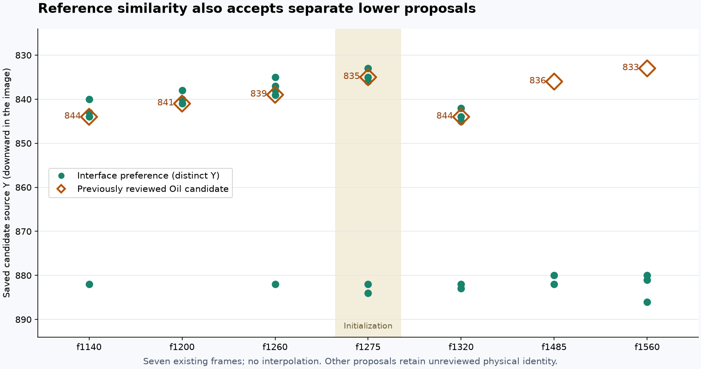

# P2 — ordered row-distribution feasibility

**Result:** The distribution pilot is CLOSED WITHOUT PROMOTION. Its unchanged mean ablation remains DIAGNOSTIC_ONLY_NO_PROMOTION: the complete saved-candidate comparison exposes separate lower matches and misses two reviewed Oil contexts. No physical selector or production consumer is supported.
The product problem is false Oil anchor admission despite retained lower
observations. This pilot tests a distinct optional-reference capability before
changing that authority: can a regional descriptor tolerate rearranged grains
while preserving the difference between a reviewed Oil context and opposition?
It does not claim to fix the new public source or the application.

[Preflight](2026-10-12-p2-row-distributions/preflight.json),
[runner / CDF verifier](2026-10-12-p2-row-distributions/run.py),
and [measured synthetic positive](2026-10-12-p2-row-distributions/synthetic-readout.json)
retain the exact inputs and operation. Current state remains in
[Work Plan](../../00-project/work-plan.md).

## Mechanism and existing ownership

Extend `tests/diagnostics/s11_boundary_temporal_probe.py`, which already owns
three-reference regional comparisons. Reuse the earlier S1 runner's `load_images`
and `region` for its pinned rasters, masks, 25×25 neighborhoods and three existing
references. The old operation and its failed outcome are unchanged.

S1 used pointwise appearance/edge correspondence, which is sensitive to changing
grains. This operation instead compares each horizontal row's empirical BGR
channel populations, retaining vertical row order and the upper/lower partition.
The physical hypothesis is conditional: within a material, grain placement may
change more than its local population, whereas crossing the material boundary
changes the ordered populations. Optical textures can share these populations;
this remains appearance preference, not physical identity.

Unlike earlier pooled LBP persistence, it uses the actual BGR distributions of
reviewed competing regional exemplars and keeps each row separate. Unlike the
closed BGR mean measurement, it retains within-row distribution shape. Horizontal
arrangement and cross-channel joint dependence are discarded; that can increase
false matches and is an explicit failure risk, not proven invariance of real Oil.
The **same-support row-mean ablation** tests whether distribution shape adds any
useful information beyond means. There is no translation/warp search, candidate
snapping, new reference or source-specific inference branch.

## Frozen operation and positive reachability

Use rows 0–10 and 14–24 of each 25×25 patch, leaving a three-row center gap.
Intersect visibility across query and all three references at the same local
coordinates. Every retained row needs at least eight common columns; otherwise
the whole comparison is unavailable, with that row retained in the record.
No source pixel or missing edge is invented. Existing candidate Y determines the
context; fractional Y retains both floor/ceil contexts and requires agreement.
These are regional bindings, not reviewed exact contours or pure material masks.

For each image, subtract one BGR offset equal to the average of its 22 row means.
For each row/channel, sort those centered common samples and take the mean
absolute paired difference. Divide by 510 and average equally over channels/rows.
Centered samples lie in [-255,255], so the cost is in [0,1]. The ablation replaces
sorted distributions with each row's centered channel mean on the same support.
A unique best cost ≤0.05 and role margin ≥0.01 yields appearance preference; exact
or near ties ≤1e-12 and missing comparisons remain unresolved. Constants are fixed
pilot choices, not a calibrated runtime operating point.

The actual synthetic operation measures a shuffled interface population plus
unclipped BGR illumination offset. It yields interface cost 0, texture cost
`(24/25)*40/510`, and structure cost `(24/25)*80/510`. All three references have
identical row means, so the ablation ties. Thus an intended positive can reach the
acceptance region; no hand-written feature vector substitutes for measurement.
Thirty-two focused tests pass, including the unchanged S1 tests, independent
empirical-CDF arithmetic, common-mask/unequal-count support, side order, additive
offset, copied-opponent ambiguity, missing references and input preservation.

## Real progression and scope

First compare only the existing **same-frame f1320** confirmed Oil context
(candidate 9/Y844) and reviewed wrong target (candidate 21/Y822), using unchanged
S1 initial/interface, structure and internal-texture references. These two must
receive interface and opposition appearance preferences respectively, while the
row-mean ablation fails at least one, before the remaining twelve S1 queries run.
A failure closes this operation without a cutoff/window/reference search.
This minimal capability requirement does not demand zero error in every video.

All six other public-source groups remain explicitly unavailable to these
sample4-specific exemplars. The new public compressor anchor also lacks a
separate same-scene initialization set: its reviewed location is not reused as
both training context and independent success. No new human label is requested.
All examples are exposed development, with no untouched holdout claim. A passing
pilot still needs broader controls, workflow-impact acceptance, and the existing
O2/V5/O3 boundaries before any typed evidence can affect production. Foam research
remains independent. No source decoder, application replay or Windows run occurs.

## Primary result and unchanged-ablation follow-up

The [readout](2026-10-12-p2-row-distributions/readout.json) ran at frozen
`9118714`. The confirmed Oil context has distribution costs interface 0.017143,
structure 0.095460, texture 0.045511 and correctly retains interface preference.
The wrong target has interface 0.112903, structure 0.068434, texture 0.080337;
its best cost exceeds 0.05 and therefore stays unresolved. The required opposition
result fails. The twelve remaining queries are NOT_RUN in this closed pilot;
no cutoff or descriptor adjustment follows. This does not prove that every
threshold would fail; no post-result threshold search was authorized or performed.

The [CDF verification](2026-10-12-p2-row-distributions/verification.json)
reconstructs 396 channel/row/role integrals on exact common pixels, all 286 input
pins and 221 unchanged production sources. Execution took 0.136 s / 90,357,760 bytes
peak RSS. The failure concerns the proposed operation, not an arithmetic defect.

The unchanged **row-mean ablation** retains interface preference on the positive
(cost 0.016015) and structure preference on the wrong target (cost 0.037415).
Its success on this one pair is exposed, exploratory evidence. The separately
[frozen follow-up](2026-10-12-p2-row-distributions/followup-preflight.json) and
[adapter](2026-10-12-p2-row-distributions/followup.py) reuse those two outputs and
measure the other twelve saved cases with unchanged references, support, offsets,
costs and cutoffs. This is a diagnostic-only continuation under the existing
successor preflight allowance, **not promotion or a new name for the failed model**.
The original stop/result stays intact. Incidental distribution fields from the
shared helper cannot reopen it. All 14 cases and unavailable sources remain visible.

## Diagnostic follow-up result

The [complete follow-up](2026-10-12-p2-row-distributions/followup-readout.json)
ran at frozen `3fe157e`, reusing the original pair and measuring the other twelve
queries. All 14 source bindings, floor/ceil summaries and non-initial counts were
checked against the unchanged S1 manifest. The two initialization contexts remain
visible but are excluded from continuation counts.

| Existing non-initial context | Interface preference | Measured opposition preference | Unresolved |
|---|---:|---:|---:|
| Confirmed Oil, 6 contexts | **4** | 0 | 2 |
| Reviewed wrong Oil targets, 3 contexts | 0 | **2** | 1 |
| Reviewed internal Foam texture, 2 contexts | 0 | **2** | 0 |
| Agent-observed old rim failure, 1 context | 0 | 0 | 1 |

These are regional reference preferences on selected, exposed contexts, **not
Oil detection accuracy, a correct-rejection rate, source coverage or runtime
improvement**. The four retained positives are f1140/f1200/f1260/f1320. At f1485,
texture cost 0.02499 is slightly below interface 0.02925; at f1560, interface 0.02285
and texture 0.02440 are too close. Both remain unresolved. The rejected f1260
context prefers structure by raw cost but exceeds the unchanged cost limit;
unresolved is not counted as successful opposition. The old rim context is also
unresolved. No remaining case is hidden or relabeled.

[Independent CDF arithmetic](2026-10-12-p2-row-distributions/followup-verification.json)
reconstructs 2,970 row/channel/role integrals across 15 neighborhoods (one fractional
candidate has two). All 290 pins and 221 production files are unchanged. The
follow-up took 0.152 s / 90,472,448 bytes peak RSS. Existing math and the failed
parent operation are unchanged; no image, candidate or video is regenerated.

**Consequence for the product:** unchanged regional row means are a useful
conditional lead worth examining against all same-frame competing proposals.
A supplied correct query location is easier than finding the right candidate;
this record has not demonstrated candidate selection. Before proposing a
consumer, freeze that candidate-level comparison, preserve the known Oil and
opposition bindings, mark every other proposal's physical identity unassessed,
and record ambiguity without choosing a nearest coordinate or lowest-cost winner
as physical truth. The original distribution pilot remains CLOSED WITHOUT
PROMOTION; this ablation remains DIAGNOSTIC_ONLY_NO_PROMOTION. No new manual setup,
source question, Windows request or field acceptance follows.

Reproduce/verify from any working directory with absolute script/input paths:

```sh
.venv/bin/python docs/50-diagnostics/s11/2026-10-12-p2-row-distributions/run.py run --manifest docs/50-diagnostics/s11/2026-10-12-p2-row-distributions/preflight.json --output /tmp/s11-row-primary.json
.venv/bin/python docs/50-diagnostics/s11/2026-10-12-p2-row-distributions/followup.py --output /tmp/s11-row-followup.json
.venv/bin/python docs/50-diagnostics/s11/2026-10-12-p2-row-distributions/run.py verify --manifest docs/50-diagnostics/s11/2026-10-12-p2-row-distributions/followup-preflight.json --readout docs/50-diagnostics/s11/2026-10-12-p2-row-distributions/followup-readout.json --output /tmp/s11-row-verification.json
```

## Frozen complete-candidate diagnostic

The [candidate preflight](2026-10-12-p2-row-distributions/candidates-preflight.json)
and [inventory adapter](2026-10-12-p2-row-distributions/candidates.py) retain all
**160 proposals in seven original saved captures**, plus the four non-candidate
controls, for 164 query records. The ten known candidate contexts and four other
controls reuse their exact previous records; 150 additional proposals are new
measurements with **UNREVIEWED** physical identity. The descriptor, references,
visibility, centering, cost limits and fractional-Y rule remain unchanged.

This answers whether selected query locations hid competing regional matches.
For each frame report all preferences, unavailability and distinct source-Y
values receiving interface preference. Equal-Y proposals share a regional crop;
they are not independent evidence. A candidate's recorded Y projected at X595 is
not a qualified dense contour or an exact fixed-X observation. Neither source
kind nor proximity to known Oil transfers a physical label. No lowest-cost
winner, automatic selector or product success is computed.

The old CDF verifier is reused unchanged through an explicit inventory adapter:
rebuild all queries from pinned capture JSON, compare that inventory to the
preflight, and pass only the expanded query list into its completeness check.
Pixel, mask, cost and hash verification remain unchanged. Additional checks bind
floor/ceil coordinates, folded preferences, original records and frame summaries.
The fixed diagnostic ends after this inventory regardless of outcome; the failed
distribution operation remains closed and all unavailable source groups stay.

## Complete-candidate result and disposition

The [readout](2026-10-12-p2-row-distributions/candidates-readout.json) ran at
frozen `35d0015`. All 160 saved proposals and four other controls are present;
all 14 prior records are unchanged. The 150 additional proposal identities stay
UNREVIEWED. No source, crop, reference, threshold or candidate was replaced.

| Frame | Proposals | Unavailable | Reviewed Oil candidate Y / mean preference | All distinct Y values with interface preference |
|---|---:|---:|---|---|
| 1140 | 24 | 5 | 844 / interface | 840, 843, 844, 882 |
| 1200 | 22 | 4 | 841 / interface | 838, 840, 841 |
| 1260 | 23 | 4 | 839 / interface | 835, 837, 838, 839, 882 |
| 1275 (initialization) | 21 | 4 | 835 / interface | 833, 835, 836, 882, 884 |
| 1320 | 25 | 6 | 844 / interface | 842, 844, 845, 882, 883 |
| 1485 | 22 | 3 | 836 / unresolved | 880, 882 |
| 1560 | 23 | 5 | 833 / unresolved | 880, 881, 886 |



The first four non-initial reviewed positives keep their earlier preference,
but separate lower contexts also qualify in f1140, f1260 and f1320. At f1485 and
f1560 the reviewed Oil candidate is unresolved while only lower proposals receive
interface preference. Their exact physical identities have not been reviewed;
these are observed coordinate/appearance alternatives, not newly labeled false
positives. An attractive regional match therefore does not supply the missing
same-interface identity or a safe automatic winner. Counting only preselected
positive/negative queries concealed this selection problem.

Across the seven captures, 33 proposals receive interface preference, often
sharing exact source Y. Those are not 33 independent observations or successes.
There are 31 unavailable records (14 out-of-crop and 17 insufficient-support
neighborhoods), all retained. The four old non-candidate controls are still in
the machine readout. Initialization and every other unavailable source group
retain their earlier scope; no general-accuracy or full-video claim follows.

The [verification](2026-10-12-p2-row-distributions/candidates-verification.json)
checks 164 exact query bindings, all floor/ceil folds, original-record equality,
complete capture inventories, frame summaries and 26,928 independent CDF
integrals. All 293 input pins and 221 production files are unchanged. Measurement
took 0.367 s / 107,151,360 bytes peak RSS. The
[plot script](2026-10-12-p2-row-distributions/plot-candidates.py) uses only this
verified readout; the plotted points are not an interpolated level trajectory.

**Decision:** end this fixed mean-only diagnostic without a consumer. It remains
a measurement of appearance, but is not an implementation-ready Oil discriminator.
Do not tune its cost/margin, replace references, choose the nearest reviewed Y,
or exclude lower candidates to rescue it. This result does not prove that every
reference-based method is impossible, nor require perfect detection of every
frame. A new P2 hypothesis still needs information that can discriminate these
alternatives; P5-a remains independent. No such next operation is established by
this record. All source questions remain closed and no Windows run is useful yet.

Reproduce the complete inventory using the same interpreter with absolute paths
when running outside the repository:

```sh
.venv/bin/python docs/50-diagnostics/s11/2026-10-12-p2-row-distributions/candidates.py run --output /tmp/s11-row-candidates.json
.venv/bin/python docs/50-diagnostics/s11/2026-10-12-p2-row-distributions/candidates.py verify --readout /tmp/s11-row-candidates.json --output /tmp/s11-row-candidates-verified.json
```

## Detector Governance

- Logic-map nodes: `FRAME-EVIDENCE`, `OIL-CANDIDATE`, `OIL-AUTHORITY`
- Failure-registry entries: `S11-F01`, `S11-F03`, `S11-F06`, `S11-F09`, `S11-F10`
- First harmful stage: current public-source evidence locates wrong completed Oil anchor admission; the frozen distribution operation leaves the primary wrong target unresolved despite retaining the positive. The unchanged mean-only diagnostic exposes separate lower matches in the complete candidate inventory and misses two reviewed Oil contexts; it supplies no physical selector or remedy.
- Logic-map impact: NONE — extends only the existing offline regional-comparison helper; no runtime caller, coordinate, material gate or selection changes.
- Failure-registry impact: NONE — existing identity, cross-material and tuning failures govern this finite hypothesis; no new field cause or remedy is asserted.
