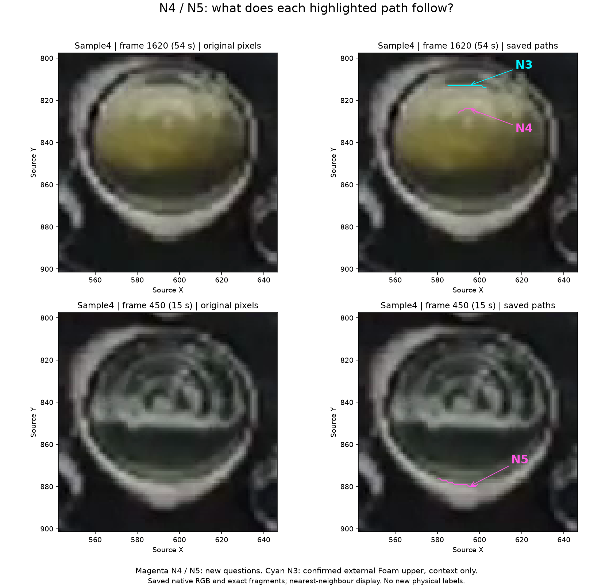

# 다른 촬영원 대조군: N4/N5 native 경로 검토 준비

기준 HEAD: `e688e7adccfe3553d9dd91b3b50ac36bfb692590`.
사용자가 **대조군을 먼저 확보한 뒤 고정 비교와 제한 학습을 진행하는 방향**을 채택했다.
이번에는 기존 저장 자료에서 새로 판단할 두 경로를 준비했다. 물리 역할은 아직 미확정이며,
모델 학습·추론·생산 detector 변경·Windows 실행은 하지 않았다.
현재 응답 상태와 실행 순서는 [Work Plan](../../00-project/work-plan.md)이 소유한다.

## 필요한 사용자 판단



그림의 **분홍색 N4와 N5**가 각각 어떤 대상을 따라가는지 확인한다.
외부 Foam 상단 / Foam 내부 변화 / 액체 상단 / 다른 실제 경계 /
구조물 경계 / 반사·광학적 경계 / 위치 근사만 허용 / 판정 불가를 구분한다.
경로 일부만 해당하면 그 범위로 제한한다. 청록색 **N3는 이미 확인된 외부 Foam
상단을 보여주는 기준**이며 다시 묻지 않는다. N1의 두 허용 해석과 N2도 그대로 유지한다.

| 새 Subject | 표시 범위 | 필요한 새 정보 |
|---|---|---|
| N4 | sample4 f1620, X595/Y824 통과, fragment 295, 11 pixels, X590–600/Y824–826 | N3 아래에 표시한 곡선의 실제 역할. 내부 변화 대조군 가능성을 검토하되 답을 미리 정하지 않음 |
| N5 | sample4 f450, X595/Y880 통과, fragment 1278, 20 pixels, X580–599/Y876–880 | 아래쪽 테두리를 따라가는 전체 경로의 역할. 구조·광학적 대조군 가능성을 검토하되 agent의 옛 wrong-region 관찰을 human truth로 바꾸지 않음 |

전체 표시 경로의 **역할 대응**을 묻는다. 정확한 픽셀 허용 오차, 주변 재질 mask,
이웃 frame, junction의 다른 arm이나 후보 family 전체의 정답을 요구하지 않는다.
기존 Y833 내부 texture guide에는 exact center edge가 없었다. 이를 N4/Y824로
옮겨 붙이지 않았으며, 옛 구간·R/L·water B/C·f1485 A/B 판정을 다시 열지도 않았다.

## 선정과 입력 가용성 확인

[proposal](../../50-diagnostics/s11/2026-10-13-native-opposition-review/review-proposal.json)은
원래 G0 manifest/readout, RGB 이미지, 전체 path 좌표/hash와 fragment fingerprint를
연결한다. 기존 lossless Canny graph를 다시 결속했으며 새 edge를 생성하지 않았다.
표시 그림은 저장 RGB를 nearest-neighbour로 확대하고 정확한 path를 겹친 것이다.

| Subject | 제안된 7×7 upper/lower 문맥의 완전한 patches | 해석 |
|---|---|---|
| N3, 기존 기준 | 19 / 19 | 기존 역할 및 입력 범위 유지 |
| N4, 새 질문 | 11 / 11 | 일부 patch는 경로를 접촉/교차하므로 순수한 side-material 정답이 아님 |
| N5, 새 질문 | 17 / 17 | 전체 경로는 20 pixels지만 G0의 fixed-X ±12 안에 실제 관측된 column은 17개 |

**N3/N4는 98개 입력 pixels를 공유**한다. N1/N2의 기존 90개 공유와 마찬가지로
한 frame의 두 경로를 독립 학습/검증 표본으로 나누지 않는다. N3/N4/N5는 모두
sample4라는 한 촬영원이며, water의 N1/N2와 구분한다. 두 영상 모두 노출된 개발
자료다. 다른 frame이나 새 주석을 얻었다는 이유로 untouched holdout이 되지 않는다.

선정 과정에서 살펴본 6개 경로의 가용성을 모두 proposal에 남겼다. f1620의 위쪽
테두리 fragment 3/24는 upper 문맥이 crop/mask 때문에 **0개**로 unavailable이다.
이를 올바른 negative rejection이나 구조물 안전성 성공으로 세지 않는다. 두 Y852
중앙 경로도 역할 미검토 상태로 유지한다. 모델 score에 맞춰 대조군을 고르거나
기존 고정 비교의 crop·scale·threshold를 바꾸지 않았다.

## 검증과 재현

- `/private/tmp`에서 실제 CLI 실행 성공. 같은 출력 경로의 두 번째 실행은
  생성 전에 거부됐고 JSON/PNG hash가 유지됐다.
- 새 두 경로 31 vertices와 N3 문맥 19 vertices의 source/frame/순서/hash를
  frozen G0와 대조했다. 각 vertex가 실제 visible Canny에 존재함도 확인했다.
- 별도 NumPy slice/usage raster로 6개 side의 완전한 footprint, crop/mask,
  입력 재사용과 98-pixel 교집합을 대조했다. [검증 기록](../../50-diagnostics/s11/2026-10-13-native-opposition-review/verification.json).
- 실제 PNG를 확인했다. 원본/경로 패널, N3와 새 질문의 구분, 경로 끝점과 라벨이
  보인다. 학습·model 호출·영상 decode는 0회다.

```bash
MPLCONFIGDIR=<new-managed-work>/.mpl \
<repo>/.venv/bin/python -B \
  <repo>/docs/50-diagnostics/s11/2026-10-13-native-opposition-review/prepare_review.py \
  --root <repo> --output-dir <new-managed-work>
```

[artifact lifecycle](../../40-operations/experiment-artifact-lifecycle.md)의 새 managed run을
만들고 실행한다. 이번 `s11-native-opposition-review-20261013-001`은 JSON·PNG·검증을
위 단일 추적 위치로 옮기고 임시 font cache를 정리했다. 원본 영상·RGB·G0·N1–N3
산출물·환경·모델은 복제하지 않았다. 기존 N1–N3 renderer는 고정된 labels/title을
가진 frozen 파일이므로 수정하지 않고, 그 원본/경로 병렬 배치를 새 질문과 닫힌
기준의 구분에 맞게 재사용했다. geometry·support 검증은 기존 G0/qualification owner를 호출한다.

두 역할을 assistant의 해석으로 확정하면 평가 정답을 스스로 만드는 문제가 된다.
따라서 **N4/N5 판단에서 멈춘다**. 답변 후 대조군 성립 여부와 출력 역할을 확정한다.
구조·반사로 확인된 경로를 옛 2-class 제안의 `INTERNAL_FOAM_CHANGE`로 강제 분류하지
않는다. 그 제안은 보류 상태이며, 새 범위에 맞는 비교·분모·실패 기준을 먼저 고정한다.

## Detector Governance

- Logic-map nodes: `FRAME-EVIDENCE`, `FOAM-CANDIDATE`, `PUBLICATION-PROVENANCE`.
- Failure-registry entries: `S11-F02`, `S11-F07`, `S11-F09`, `S11-F10`.
- First harmful stage: 새 물리 효능/실패는 미평가. native path와 기존 proposed-input 가용성만 검증했으며, N4/N5의 물리 역할과 구조·반사 구분은 새 human correspondence가 필요함.
- Logic-map impact: NONE — 기존 저장 경로의 검토 자료 준비만 수행. detector 실행·후보·schema·selector·publication 변경 없음.
- Failure-registry impact: NONE — guide 근접성이나 geometry를 물리 정답으로 승격하지 않음. unavailable upper-rim과 공유 문맥을 보존하며 실패 family나 repair 성공을 추가하지 않음.
